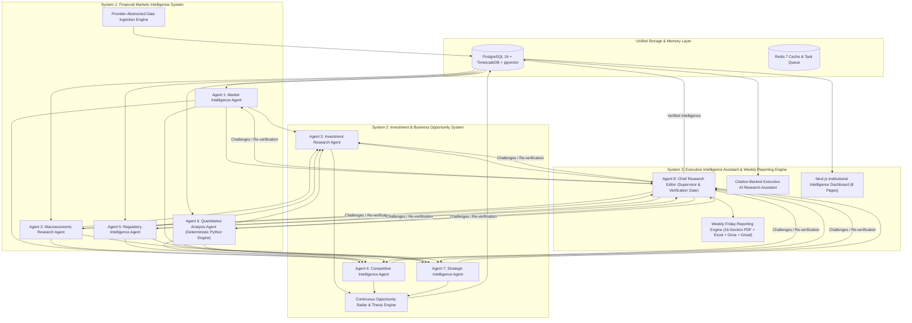
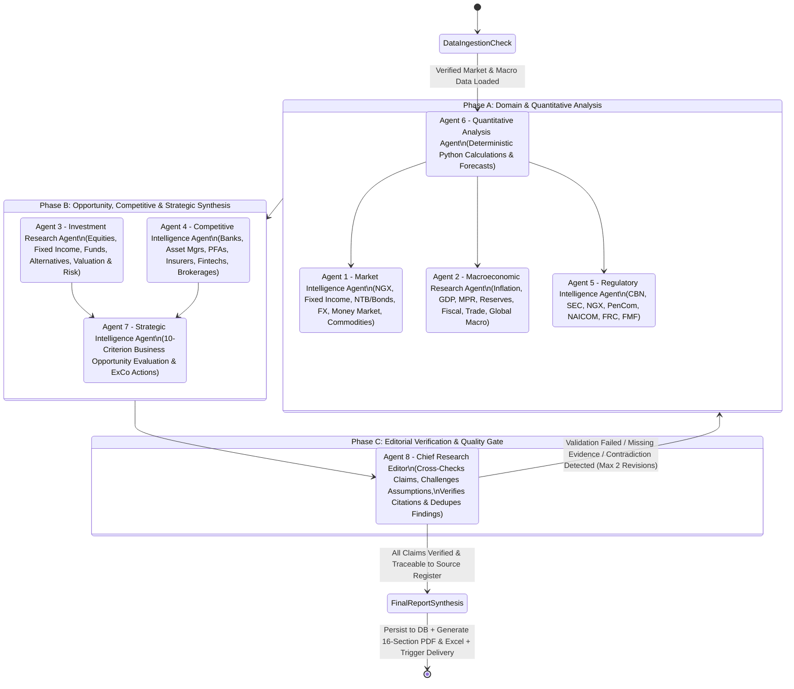

# Institutional Financial Markets Intelligence Platform (FMIP) — System Architecture

## 1. Executive Architecture Overview

The **Financial Markets Intelligence Platform (FMIP)** is an institutional-grade AI research, quantitative analytics, opportunity discovery, and executive reporting system engineered for a Nigerian financial services holding company, asset management firm, investment management company, and senior executive leadership.

Rather than operating as a conversational wrapper or static dashboard, FMIP operates as an **autonomous, multi-agent institutional research department** anchored by three tightly integrated core systems sharing a unified PostgreSQL + TimescaleDB + pgvector database:



---

## 2. Technology Stack Confirmation

Every component of the mandatory technology stack has been validated for institutional reliability, deterministic financial computation, and production scalability. No substitutions are required.

| Layer | Mandatory Technology | Version / Runtime | Architectural Role & Justification |
| :--- | :--- | :--- | :--- |
| **Primary LLM & Embeddings** | Google Gemini API (`google-genai`) | `gemini-2.5-pro`, `gemini-2.5-flash`, `text-embedding-004` | Long-context financial synthesis, structured Pydantic outputs, tool calling, and 768-dim semantic embeddings. |
| **Multi-Agent Orchestration** | LangGraph | `>=0.3.x` | Cyclic state-graph orchestration enabling the Chief Research Editor (Agent 8) to reject unsupported claims and loop back to domain agents. |
| **Agent & Backend Language** | Python + Pydantic v2 | Python `3.11+`, Pydantic `>=2.10` | Strict runtime schema validation for every data point, citation, 11-question development record, and agent output. |
| **Backend API Framework** | FastAPI + SQLAlchemy 2.0 + Alembic | FastAPI `>=0.115`, SQLAlchemy `>=2.0.36`, Alembic `>=1.14` | Async REST endpoints, strict OpenAPI schemas, RBAC middleware, audit logging, and declarative database migrations. |
| **Quantitative & Statistical Engine** | Pandas, NumPy, SciPy, Scikit-learn, Statsmodels, Plotly | Latest stable Python 3.11 scientific stack | Deterministic financial calculations, yield curve interpolation (Nelson-Siegel), ARIMA/SARIMAX/ETS/Ridge forecasting, backtesting, and chart generation. |
| **Database & Time-Series** | PostgreSQL 16 + TimescaleDB + pgvector | `timescale/timescaledb-ha:pg16` | Unified ACID relational store (`PostgreSQL`), high-performance time-series hypertables (`TimescaleDB`), and semantic vector search (`pgvector`). |
| **Cache & Background Workers** | Redis | Redis `7-alpine` | API response caching, token bucket rate limiting, and distributed background job queues. |
| **Frontend Dashboard** | Next.js (App Router) + React + TypeScript + Tailwind CSS + shadcn/ui | Next.js `15.x`, React `19.x`, TypeScript `5.x` | Responsive 8-page institutional intelligence terminal with dark/light executive styling and server/client data fetching. |
| **Financial Visualisation** | TradingView Lightweight Charts, Recharts, Plotly | `lightweight-charts`, `recharts`, `plotly.js` | Candlestick/OHLCV market charts, yield curves, macroeconomic trends, correlation heatmaps, and scenario fan charts. |
| **Research & Data Collection** | Tavily API, Google Search, FMP API, Alpha Vantage, FRED, Nigerian Official Adapters | Abstracted via `BaseMarketDataProvider` & `BaseRegulatoryProvider` | Provider-agnostic data ingestion covering Nigerian (CBN, NGX, FMDQ, DMO, NBS, SEC, PenCom, NAICOM), African, and global markets. |
| **Workflow Automation** | n8n + Redis Workers | `n8nio/n8n:latest` | Visual and cron-scheduled execution of daily market monitoring, regulatory polling, alert routing, and Friday 16:30 WAT report delivery. |
| **Report Generation & Delivery** | ReportLab, OpenPyXL, Google Drive API, Gmail API / SMTP | `reportlab`, `openpyxl`, `google-api-python-client` | Institutional multi-page PDF publication, multi-sheet formatted Excel data workbooks, automated cloud archiving, and executive email distribution. |
| **Deployment & DevOps** | Docker, Docker Compose, AWS, GitHub Actions | Docker `29+`, Compose v2 | Containerized local development and production AWS deployment (ECS/EC2, RDS/Timescale, ElastiCache Redis, S3/Drive backup). |

---

## 3. Detailed Project Folder Structure

```text
Research_Agent/
├── .env.example                           # Complete environment variable template
├── .gitignore                             # Git exclusion rules protecting secrets & artifacts
├── docker-compose.yml                     # Local orchestration (TimescaleDB+pgvector, Redis, Backend, Worker, Frontend, n8n)
├── README.md                              # Master documentation, setup, and runbook
├── PROGRESS_TRACKER.md                    # Live phase-by-phase engineering status tracker
├── .github/
│   └── workflows/
│       └── ci.yml                         # Automated linting, unit tests, quant verification & build pipeline
├── docker/
│   ├── postgres/
│   │   └── init-extensions.sql            # Enables timescaledb, vector, uuid-ossp, pg_trgm
│   ├── backend/
│   │   └── Dockerfile                     # Production Python 3.11 FastAPI + ReportLab image
│   └── frontend/
│       └── Dockerfile                     # Production Next.js multi-stage image
├── docs/
│   ├── ARCHITECTURE.md                    # System architecture, data flows & security model
│   ├── DATABASE_SCHEMA.md                 # Complete database schema & ERD documentation
│   └── API_REQUIREMENTS.md                # External API setup guide, Nigerian sources & cost analysis
├── scripts/
│   ├── backup_db.sh                       # Automated PostgreSQL/TimescaleDB backup script
│   └── seed_initial_data.py               # Bootstraps roles, data source registry & verified historical baseline
├── storage/
│   └── reports/
│       ├── pdf/                           # Generated Friday Weekly Intelligence PDFs
│       └── excel/                         # Generated Friday Weekly Intelligence Excel workbooks
├── n8n/
│   └── workflows/
│       ├── 01_daily_market_and_macro_ingestion.json
│       ├── 02_regulatory_and_competitor_monitor.json
│       ├── 03_opportunity_radar_alerts.json
│       └── 04_friday_weekly_intelligence_report.json
├── backend/
│   ├── pyproject.toml                     # Python package dependencies & pytest/ruff config
│   ├── requirements.txt                   # Pinned dependencies for reproducible installs
│   ├── alembic.ini                        # Alembic database migration configuration
│   ├── app/
│   │   ├── main.py                        # FastAPI application entrypoint, middleware & routers
│   │   ├── core/
│   │   │   ├── config.py                  # Pydantic Settings configuration loader
│   │   │   ├── security.py                # JWT auth, password hashing, RBAC & prompt-injection sanitizer
│   │   │   ├── rate_limit.py              # Redis-backed API rate limiter
│   │   │   └── logging.py                 # Structured JSON audit and application logging
│   │   ├── db/
│   │   │   ├── session.py                 # SQLAlchemy engine & session management
│   │   │   ├── base.py                    # Declarative model registry
│   │   │   └── migrations/                # Alembic migration scripts
│   │   ├── models/                        # SQLAlchemy ORM models (16 core tables)
│   │   │   ├── user.py                    # User, Role, AuditLog
│   │   │   ├── source.py                  # DataSource, SourceRegister
│   │   │   ├── market.py                  # MarketTimeseries (TimescaleDB), YieldCurvePoint
│   │   │   ├── macro.py                   # MacroIndicator (TimescaleDB)
│   │   │   ├── document.py                # ResearchDocument, DocumentChunk (pgvector)
│   │   │   ├── intelligence.py            # MarketDevelopment (11-question framework), CompetitorProfile, CompetitorEvent, RegulatoryEvent
│   │   │   ├── opportunity.py             # Opportunity (Investment & Business Radar)
│   │   │   ├── forecast.py                # QuantForecast, ForecastBacktest
│   │   │   └── report.py                  # AgentRun, EditorialReview, WeeklyReport, AlertPreference
│   │   ├── schemas/                       # Strict Pydantic v2 schemas for APIs & Agent structured outputs
│   │   ├── providers/                     # Provider-abstracted data collection layer
│   │   │   ├── base.py                    # Abstract interfaces: BaseMarketProvider, BaseMacroProvider, BaseSearchProvider, BaseRegulatoryProvider
│   │   │   ├── quality.py                 # Data validation, deduplication hashing, staleness & anomaly checks
│   │   │   ├── nigerian/                  # CBN, NGX, FMDQ, DMO, NBS, SEC Nigeria, PenCom, NAICOM adapters
│   │   │   ├── global_markets/            # Financial Modeling Prep (FMP), Alpha Vantage, FRED adapters
│   │   │   └── search/                    # Tavily Search API, Google Custom Search & Annual Report PDF extractor
│   │   ├── quant/                         # Deterministic Python Quantitative & Statistical Engine
│   │   │   ├── market_metrics.py          # Returns, moving averages (SMA/EMA), volatility, drawdown, Sharpe/Sortino
│   │   │   ├── fixed_income.py            # Yield curve analysis, Nelson-Siegel fitting, duration, convexity, term spreads
│   │   │   ├── econometrics.py            # Correlation matrices, OLS/multi-factor regression, stationarity (ADF)
│   │   │   ├── valuation.py               # Financial ratios, DCF/Gordon Growth, relative valuation multiples
│   │   │   └── forecasting.py             # ARIMA/SARIMAX, Exponential Smoothing, Ridge/ML forecasting, scenario generator & walk-forward backtesting
│   │   ├── agents/                        # LangGraph 8-Agent Architecture
│   │   │   ├── state.py                   # Typed ResearchGraphState shared across the 8 agents
│   │   │   ├── graph.py                   # LangGraph state machine definition & conditional editorial routing
│   │   │   ├── llm.py                     # Gemini client factory with structured output enforcement
│   │   │   ├── tools/                     # Deterministic tools exposed to agents (DB query, quant execution, search)
│   │   │   └── nodes/
│   │   │       ├── agent_1_market.py      # Agent 1: Market Intelligence Agent
│   │   │       ├── agent_2_macro.py       # Agent 2: Macroeconomic Research Agent
│   │   │       ├── agent_3_investment.py  # Agent 3: Investment Research Agent
│   │   │       ├── agent_4_competitor.py  # Agent 4: Competitive Intelligence Agent
│   │   │       ├── agent_5_regulatory.py  # Agent 5: Regulatory Intelligence Agent
│   │   │       ├── agent_6_quant.py       # Agent 6: Quantitative Analysis Agent
│   │   │       ├── agent_7_strategic.py   # Agent 7: Strategic Intelligence Agent
│   │   │       └── agent_8_editor.py      # Agent 8: Chief Research Editor
│   │   ├── reporting/
│   │   │   ├── pdf_generator.py           # ReportLab 16-section institutional PDF generator
│   │   │   ├── excel_generator.py         # OpenPyXL multi-sheet data & financial model workbook generator
│   │   │   ├── drive_archiver.py          # Google Drive API v3 upload & folder archiving service
│   │   │   └── email_delivery.py          # Gmail API / SMTP HTML executive brief & attachment delivery
│   │   ├── services/
│   │   │   ├── ingestion_service.py       # Orchestrates data retrieval, validation & persistence
│   │   │   ├── radar_service.py           # Continuous Investment & Business Opportunity Radar engine
│   │   │   ├── assistant_service.py       # Citation-backed RAG Executive Research Assistant
│   │   │   └── report_service.py          # End-to-end Friday-to-Friday report orchestration
│   │   ├── workers/
│   │   │   └── runner.py                  # Redis-backed background worker for scheduled & async jobs
│   │   └── api/v1/endpoints/              # FastAPI REST endpoints
│   │       ├── auth.py                    # Login, JWT token refresh, RBAC user management
│   │       ├── overview.py                # Executive summary & 5 key strategic questions endpoint
│   │       ├── markets.py                 # Nigerian & Global market data, yield curves, commodities
│   │       ├── macro.py                   # Macroeconomic indicators & forecasts
│   │       ├── opportunities.py           # Opportunity Radar endpoints & thesis inspection
│   │       ├── competitors.py             # Competitive intelligence profiles & activity feed
│   │       ├── regulatory.py              # Regulatory circulars, compliance impact & filters
│   │       ├── reports.py                 # Weekly reports list, on-demand generation, PDF/Excel downloads
│   │       ├── assistant.py               # Citation-backed AI Research Assistant query endpoint
│   │       └── webhooks.py                # Authenticated n8n automation triggers
│   └── tests/                             # Comprehensive test suite (Unit + Integration)
└── frontend/                              # Next.js TypeScript Tailwind shadcn/ui Dashboard
    ├── package.json
    ├── tsconfig.json
    ├── tailwind.config.ts
    └── src/
        ├── app/
        │   ├── login/                     # Institutional authentication page
        │   └── (dashboard)/
        │       ├── overview/              # Page 1: Executive Overview
        │       ├── nigerian-markets/      # Page 2: Nigerian Markets (NGX, FMDQ, NTB, FGN Bonds, FX)
        │       ├── global-markets/        # Page 3: Global Markets (Equities, Bonds, FX, Commodities)
        │       ├── opportunity-radar/     # Page 4: Investment & Business Opportunity Radar
        │       ├── competitive-intelligence/ # Page 5: Competitor Profiles & Activity Matrix
        │       ├── regulatory-monitor/    # Page 6: CBN, SEC, NGX, PenCom, NAICOM Monitor
        │       ├── research-reports/      # Page 7: Weekly Friday Reports & Searchable Archive
        │       ├── ai-assistant/          # Page 8: Citation-Backed Executive AI Research Assistant
        │       └── settings/              # Schedule, Alert Preferences & Data Source Status
        ├── components/                    # Reusable shadcn/ui & financial chart components
        └── lib/                           # API client, authentication hooks & formatters
```

---

## 4. Multi-Agent Architecture & Interaction Diagram

FMIP uses a **Supervisor-Editor Cyclic State Graph** in LangGraph. A critical architectural rule is enforced:
> **Zero Hallucinated Math Policy**: Language models are strictly forbidden from performing mental arithmetic or inventing financial figures. All metrics, returns, yield curve spreads, valuations, correlations, regressions, and forecasts are computed by **Agent 6 (Quantitative Analysis Agent)** invoking validated Python functions in `app/quant/`, and injected into the shared `ResearchGraphState` as immutable, signed quantitative artifacts.



### Detailed Agent Responsibilities & Tool Boundaries

| Agent | Role & Scope | Mandatory Inputs | Permitted Tools | Structured Output Schema |
| :--- | :--- | :--- | :--- | :--- |
| **Agent 1: Market Intelligence Agent** | Monitors NGX equities, global indices, FMDQ fixed income, NTBs, FGN Bonds, NAFEM/official FX, money markets (OPR/OVN), and commodities (Brent, Bonny Light, Gold, Cocoa). | `market_timeseries`, `yield_curves`, `quant_metrics` from Agent 6, verified market news. | `query_market_timeseries`, `get_yield_curve_snapshot`, `get_quant_performance_table`, `search_verified_news` | `MarketIntelligenceOutput` (11-question developments, asset class performance tables, source citations). |
| **Agent 2: Macroeconomic Research Agent** | Monitors Nigerian & global inflation (headline/food/core CPI), GDP growth, CBN MPR/CRR, foreign reserves, fiscal deficit/debt service, PMI, trade balance, and global central banks (Fed, ECB, BoE). | `macro_indicators`, `quant_forecasts` from Agent 6, NBS/CBN/FRED publications. | `query_macro_indicators`, `get_macro_correlations`, `get_macro_forecasts`, `search_official_macro_releases` | `MacroResearchOutput` (macro developments, transmission mechanisms to markets/businesses, citations). |
| **Agent 3: Investment Research Agent** | Evaluates equities, FGN bonds, NTBs, commercial papers, mutual funds, and alternative investments. Conducts fundamental, valuation, and risk analysis. Refuses recommendations when data is insufficient. | Agent 1 & 2 outputs, Agent 6 valuation/yield metrics, company financial statements. | `get_equity_valuation_metrics`, `get_fixed_income_real_yields`, `get_risk_return_metrics`, `query_financial_statements` | `InvestmentResearchOutput` (instrument analyses, evidence-gated investment theses, explicit risk/return profiles). |
| **Agent 4: Competitive Intelligence Agent** | Tracks 9 competitor segments (Asset Managers, Commercial Banks, Investment Banks, PFAs, Insurers, Fintechs, Brokerages, Platforms, Wealth Managers) across product launches, M&A, pricing, and market share. | `competitor_profiles`, `competitor_events`, SEC/CBN/NGX filings, verified press. | `query_competitor_events`, `search_competitor_filings`, `compare_competitor_positioning` | `CompetitiveIntelligenceOutput` (competitor moves, strategic differentiation, implications for our holding company). |
| **Agent 5: Regulatory Intelligence Agent** | Monitors CBN circulars, SEC rules, NGX regulations, PenCom guidelines, NAICOM directives, FRC standards, and Federal Ministry of Finance policies. Prioritizes Tier-1 official publications. | `regulatory_events`, official regulatory documents in `research_documents`. | `query_regulatory_circulars`, `semantic_search_regulations`, `assess_compliance_impact` | `RegulatoryIntelligenceOutput` (policy changes, mandatory compliance actions, capital impact, regulatory arbitrage/opportunities). |
| **Agent 6: Quantitative Analysis Agent** | Executes all numerical calculations in Python: historical returns, SMA/EMA, annualized volatility, correlation matrices, OLS regressions, Nelson-Siegel yield curve metrics, financial ratios, scenario/sensitivity tables, ARIMA/SARIMAX/ETS forecasts, and backtests. | Raw verified series from `market_timeseries`, `macro_indicators`, `yield_curves`. | `run_market_analytics`, `run_yield_curve_analytics`, `run_correlation_and_regression`, `run_time_series_forecast_with_backtest`, `run_scenario_sensitivity` | `QuantitativeAnalysisOutput` (deterministic tables, regression stats, backtest RMSE/MAPE, Base/Bull/Bear forecast bands). |
| **Agent 7: Strategic Intelligence Agent** | Translates findings from Agents 1–6 into actionable business intelligence across 8 service lines (Asset Mgmt, Investment Banking, Wealth Mgmt, Advisory, Fintech, Alternatives, Capital Markets, Institutional Services) scored on 10 criteria. | Outputs from Agents 1–6, `opportunities` database history. | `score_strategic_opportunity`, `query_opportunity_history`, `evaluate_capital_and_regulatory_fit` | `StrategicIntelligenceOutput` (10-criterion scored business opportunities, management action plan). |
| **Agent 8: Chief Research Editor** | Supervises the entire research cycle. Audits every number against Agent 6 output, verifies every citation against `source_register`, resolves contradictions across agents, strips unsupported claims, ranks risks/opportunities, and compiles the 16-section executive report. | Draft outputs from Agents 1–7, `source_register`, `quant_metrics`. | `verify_claim_against_source_register`, `audit_numbers_against_quant_engine`, `request_agent_revision`, `publish_weekly_report` | `EditorialReviewRecord` + `FinalWeeklyIntelligenceReport` (16 institutional sections). |

---

## 5. End-to-End Data Flows

### 5.1 Data Ingestion & Quality Verification Flow
1. **Scheduled / Triggered Fetch**: n8n or the Redis worker invokes `IngestionService`.
2. **Provider Abstraction**: Data is retrieved through modular adapters (`CBNProvider`, `NGXProvider`, `FMDQProvider`, `DMOProvider`, `FMPProvider`, `AlphaVantageProvider`, `FREDProvider`, `TavilySearchProvider`).
3. **Untrusted Content Sanitization**: All external text (news, HTML, PDFs) passes through `PromptInjectionSanitizer` to strip instruction-override patterns and encapsulate external text in data-only XML tags.
4. **Deduplication & Provenance Tagging**: A deterministic SHA-256 hash (`indicator_name + reporting_period + source_id` for data points; `canonical_url + content_hash` for documents) prevents duplicate storage. Every data point records `indicator_name`, `value`, `currency_or_unit`, `reporting_period`, `publication_date`, `retrieval_date`, `source_id`, `data_frequency`, and `verification_status`.
5. **Quality Validation Gate**:
   - Missing values are **never** silently interpolated or fabricated.
   - Outliers exceeding $4\sigma$ from rolling historical volatility or lacking a primary Tier-1/Tier-2 source are flagged with `verification_status = 'FLAGGED_UNVERIFIED'`.

### 5.2 The 11-Question Analytical Engine Flow
For every significant market, macroeconomic, competitive, or regulatory development, the agents must populate the structured 11-question analytical matrix:
1. **What happened?** (Factual description with exact dates and figures)
2. **Why did it happen?** (Immediate catalyst)
3. **What caused it?** (Underlying structural or policy root cause)
4. **Why is it significant?** (Quantitative magnitude vs. historical percentiles)
5. **Who benefits?** (Specific sectors, institutions, or asset classes)
6. **Who loses?** (Adversely affected market participants)
7. **What are the immediate implications?** (0–30 day market/liquidity impact)
8. **What are the long-term implications?** (3–24 month structural impact)
9. **What opportunities does it create?** (Actionable investment or business opportunities)
10. **What risks does it introduce?** (Credit, FX, liquidity, regulatory, or operational risks)
11. **What should management consider doing?** (Concrete options for ExCo / Investment Committee)

Each statement is explicitly tagged with its epistemological class:
- `FACT`: Directly verified from Tier-1/Tier-2 primary data or regulatory filing.
- `ESTIMATE`: Derived via documented quantitative methodology when primary reporting is lagged.
- `OPINION`: Attributed external commentary from named analysts or market participants.
- `AI_INTERPRETATION`: Analytical synthesis generated by FMIP agents from verified facts.

### 5.3 Friday-to-Friday Weekly Reporting Flow
1. **Reporting Window Calculation**: Automatically computes the previous Friday 16:00 WAT to current Friday 16:00 WAT window, adjusting for Nigerian public holidays (e.g., Eid, Independence Day, Christmas) and data publication lags.
2. **8-Agent LangGraph Execution**: Executes Phase A $\rightarrow$ Phase B $\rightarrow$ Phase C (with Chief Research Editor quality gate).
3. **Artifact Generation**:
   - **PDF Report (`ReportLab`)**: Institutional publication with cover page, table of contents, executive summary, all 16 mandatory sections, formatted tables, embedded high-resolution charts, and complete numbered Source Register.
   - **Excel Workbook (`OpenPyXL`)**: Multi-tab workbook (`Executive_Summary`, `NGX_Equities`, `Fixed_Income_Yield_Curve`, `FX_and_Money_Market`, `Macro_Indicators`, `Quant_Forecasts_Backtests`, `Opportunity_Radar`, `Source_Register`).
4. **Archiving & Delivery**: Uploads PDF and Excel to Google Drive folder, stores metadata in PostgreSQL, updates the Next.js dashboard in real time, and sends an executive HTML email with attachments via Gmail.

---

## 6. Security, Prompt Injection Defense & Governance

1. **Untrusted External Input Isolation**:
   - External articles, scraped regulatory pages, and PDF text are scanned for adversarial prompt injection patterns (`ignore previous instructions`, `system prompt`, `you are now`, role-hijacking tokens).
   - Flagged segments are sanitized and logged in `audit_logs`.
   - External content is wrapped in `<untrusted_external_evidence source_id="...">...</untrusted_external_evidence>` delimiters with system instructions prohibiting execution of commands inside evidence blocks.
2. **Role-Based Access Control (RBAC)**:
   - `EXECUTIVE_ADMIN`: Full system configuration, user management, manual report trigger, all research & settings.
   - `RESEARCH_ANALYST`: Trigger research runs, review/verify flagged data points, view all dashboards and reports.
   - `PORTFOLIO_MANAGER`: View dashboards, Opportunity Radar, quantitative forecasts, reports, and query AI Research Assistant.
   - `BOARD_VIEWER`: Read-only access to Overview, Weekly Reports, and Executive Summaries.
3. **Decision-Support Boundary**:
   - The system contains zero order-execution or brokerage trading connectors. All outputs carry explicit institutional governance metadata confirming they are decision-support research for management and investment committee consideration.
