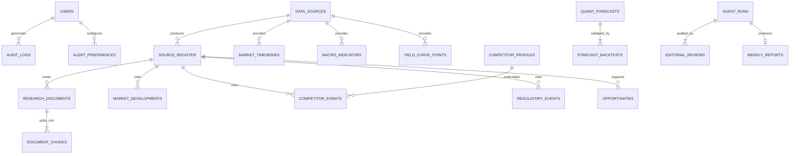

# Database Design & Schema Specification (PostgreSQL 16 + TimescaleDB + pgvector)

## 1. Architectural Overview

The FMIP persistence layer runs on **PostgreSQL 16** enhanced with two specialized extensions:
1. **TimescaleDB**: Partitions high-frequency and historical financial market data (`market_timeseries`, `yield_curve_points`, `macro_indicators`) into time-partitioned **hypertables** for fast time-window queries, rolling aggregations, and historical comparisons.
2. **pgvector**: Stores 768-dimensional vector embeddings (`models/text-embedding-004`) in `document_chunks` using an **HNSW** (`vector_cosine_ops`) index for sub-50ms semantic retrieval across regulatory circulars, annual reports, financial news, and historical weekly intelligence reports.

---

## 2. Entity-Relationship Diagram (ERD)

---

## 3. Mandatory Provenance & Data Quality Contract

Per Section 4 of the specification, **every financial and macroeconomic data point** stored in `market_timeseries`, `macro_indicators`, and `yield_curve_points` enforces the following mandatory provenance columns:

| Column | Type | Constraint | Purpose |
| :--- | :--- | :--- | :--- |
| `indicator_name` | `VARCHAR(255)` | `NOT NULL` | Standardized indicator or instrument name (e.g., `NGX_ASI`, `CBN_MPR`, `NGN_USD_NAFEM`, `NTB_364D_STOP_RATE`). |
| `value` | `NUMERIC(20, 6)` | `NOT NULL` | Primary numeric value (close price, yield %, rate, index level). |
| `currency_or_unit` | `VARCHAR(64)` | `NOT NULL` | Exact unit (e.g., `NGN`, `USD`, `PERCENT`, `BPS`, `INDEX_POINTS`, `USD_BILLION`, `BBL_USD`). |
| `reporting_period` | `VARCHAR(64)` | `NOT NULL` | Period covered by the figure (e.g., `2026-11-25`, `2026-Q3`, `2026-10`). |
| `publication_date` | `TIMESTAMPTZ` | `NOT NULL` | Official publication timestamp from the issuing authority or exchange. |
| `retrieval_date` | `TIMESTAMPTZ` | `NOT NULL` | Exact UTC timestamp when FMIP ingested the record. |
| `source_id` | `UUID` | `FK -> data_sources.id` | Traceable link to the verified provider in `data_sources`. |
| `data_frequency` | `VARCHAR(32)` | `NOT NULL` | `INTRADAY` \| `DAILY` \| `WEEKLY` \| `MONTHLY` \| `QUARTERLY` \| `ANNUAL` \| `EVENT_DRIVEN`. |
| `verification_status` | `VARCHAR(32)` | `NOT NULL` | `VERIFIED` \| `PENDING_CROSS_CHECK` \| `FLAGGED_UNVERIFIED` \| `STALE_WARNING`. |
| `dedup_hash` | `VARCHAR(64)` | `UNIQUE / INDEX` | Deterministic SHA-256 hash preventing duplicate ingestion. |

---

## 4. Detailed Table Specifications (18 Production Tables)

### 4.1 Security, Governance & Audit Tables

#### `users`
- `id` (`UUID`, PK)
- `email` (`VARCHAR(255)`, Unique, Not Null)
- `full_name` (`VARCHAR(255)`, Not Null)
- `hashed_password` (`VARCHAR(255)`, Not Null)
- `role` (`VARCHAR(50)`, Not Null: `EXECUTIVE_ADMIN`, `RESEARCH_ANALYST`, `PORTFOLIO_MANAGER`, `BOARD_VIEWER`)
- `is_active` (`BOOLEAN`, Default `True`)
- `last_login_at` (`TIMESTAMPTZ`)
- `created_at`, `updated_at` (`TIMESTAMPTZ`)

#### `audit_logs`
- `id` (`UUID`, PK)
- `user_id` (`UUID`, FK `users.id`, Nullable for automated jobs)
- `action` (`VARCHAR(128)`, Not Null — e.g., `LOGIN`, `TRIGGER_WEEKLY_REPORT`, `PROMPT_INJECTION_BLOCKED`, `DATA_QUALITY_FLAGGED`)
- `resource_type` (`VARCHAR(64)`, Not Null)
- `resource_id` (`VARCHAR(128)`)
- `ip_address` (`VARCHAR(64)`)
- `details` (`JSONB`, Not Null)
- `created_at` (`TIMESTAMPTZ`, Indexed)

---

### 4.2 Source Registry & Provenance Tables

#### `data_sources`
- `id` (`UUID`, PK)
- `code` (`VARCHAR(64)`, Unique — e.g., `CBN_OFFICIAL`, `NGX_OFFICIAL`, `FMDQ_OFFICIAL`, `DMO_OFFICIAL`, `NBS_OFFICIAL`, `SEC_NIGERIA`, `PENCOM`, `NAICOM`, `FMP_API`, `ALPHA_VANTAGE`, `FRED_API`, `TAVILY_SEARCH`)
- `name` (`VARCHAR(255)`, Not Null)
- `category` (`VARCHAR(64)` — `REGULATOR`, `EXCHANGE`, `STATISTICAL_BUREAU`, `MARKET_DATA_API`, `FINANCIAL_PRESS`)
- `country` (`VARCHAR(64)` — `NIGERIA`, `AFRICA`, `GLOBAL`, `USA`)
- `base_url` (`TEXT`)
- `reliability_tier` (`VARCHAR(32)`, Not Null — `TIER_1_OFFICIAL`, `TIER_2_INSTITUTIONAL`, `TIER_3_FINANCIAL_PRESS`, `TIER_4_SECONDARY`)
- `is_active` (`BOOLEAN`, Default `True`)
- `last_successful_fetch_at` (`TIMESTAMPTZ`)

#### `source_register`
Maintains the immutable citation ledger required by Section 5 and Section 7 (Section 16 of every Weekly Report):
- `id` (`UUID`, PK)
- `source_id` (`UUID`, FK `data_sources.id`, Not Null)
- `source_name` (`VARCHAR(255)`, Not Null)
- `publication_title` (`TEXT`, Not Null)
- `publication_date` (`TIMESTAMPTZ`, Not Null)
- `retrieval_date` (`TIMESTAMPTZ`, Not Null)
- `url` (`TEXT`, Not Null)
- `canonical_hash` (`VARCHAR(64)`, Unique — SHA-256 of normalized URL + publication date)
- `relevant_finding` (`TEXT`, Not Null)
- `reliability_classification` (`VARCHAR(32)`, Not Null — `TIER_1_OFFICIAL`, `TIER_2_INSTITUTIONAL`, `TIER_3_FINANCIAL_PRESS`, `TIER_4_SECONDARY`)
- `epistemic_type` (`VARCHAR(32)`, Not Null — `FACT`, `ESTIMATE`, `OPINION`, `AI_INTERPRETATION`)
- `verification_status` (`VARCHAR(32)`, Not Null — `VERIFIED`, `FLAGGED_UNVERIFIED`)
- `metadata_json` (`JSONB`)

---

### 4.3 Financial & Macroeconomic Time-Series Hypertables (TimescaleDB)

#### `market_timeseries` (TimescaleDB Hypertable partitioned on `publication_date`)
- `id` (`UUID`, Composite PK with `publication_date`)
- `symbol` (`VARCHAR(64)`, Not Null, Indexed — e.g., `NGXASI`, `DANGCEM.NG`, `GTCO.NG`, `ZENITHBANK.NG`, `MTNN.NG`, `SEPLAT.NG`, `NGNUSD.NAFEM`, `BRENT`, `BONNYLIGHT`, `SPX`, `NDX`, `DXY`, `GOLD`)
- `indicator_name` (`VARCHAR(255)`, Not Null)
- `asset_class` (`VARCHAR(64)`, Not Null — `EQUITY`, `INDEX`, `FX`, `FIXED_INCOME`, `MONEY_MARKET`, `COMMODITY`)
- `market_region` (`VARCHAR(64)`, Not Null — `NIGERIA`, `AFRICA`, `GLOBAL`)
- `value` (`NUMERIC(20, 6)`, Not Null — primary close/rate/yield)
- `open_value` (`NUMERIC(20, 6)`)
- `high_value` (`NUMERIC(20, 6)`)
- `low_value` (`NUMERIC(20, 6)`)
- `close_value` (`NUMERIC(20, 6)`)
- `volume` (`NUMERIC(24, 4)`)
- `market_cap` (`NUMERIC(24, 2)`)
- `currency_or_unit` (`VARCHAR(64)`, Not Null)
- `reporting_period` (`VARCHAR(64)`, Not Null)
- `publication_date` (`TIMESTAMPTZ`, Not Null, Hypertable Time Dimension)
- `retrieval_date` (`TIMESTAMPTZ`, Not Null)
- `source_id` (`UUID`, FK `data_sources.id`, Not Null)
- `data_frequency` (`VARCHAR(32)`, Not Null)
- `verification_status` (`VARCHAR(32)`, Not Null)
- `quality_flags` (`JSONB` — records any outlier or cross-check flags)
- `dedup_hash` (`VARCHAR(64)`, Not Null, Indexed)

#### `yield_curve_points` (TimescaleDB Hypertable partitioned on `publication_date`)
Tracks Nigerian Treasury Bills (91D, 182D, 364D), FGN Bonds (2Y, 3Y, 5Y, 7Y, 10Y, 15Y, 20Y, 30Y), CBN OMO Bills, and US Treasury benchmark curves:
- `id` (`UUID`, Composite PK with `publication_date`)
- `curve_name` (`VARCHAR(64)`, Not Null — `NGN_SOVEREIGN_FMDQ`, `NGN_NTB_AUCTION`, `USD_UST_BENCHMARK`)
- `instrument_type` (`VARCHAR(64)`, Not Null — `NTB`, `OMO_BILL`, `FGN_BOND`, `US_TREASURY`)
- `tenor_label` (`VARCHAR(32)`, Not Null — `91D`, `182D`, `364D`, `2Y`, `5Y`, `10Y`, `20Y`, `30Y`)
- `tenor_days` (`INTEGER`, Not Null)
- `tenor_years` (`NUMERIC(10, 4)`, Not Null)
- `indicator_name` (`VARCHAR(255)`, Not Null)
- `value` (`NUMERIC(12, 6)`, Not Null — Yield % p.a.)
- `coupon_rate` (`NUMERIC(12, 6)`)
- `bid_to_cover` (`NUMERIC(12, 4)`)
- `currency_or_unit` (`VARCHAR(32)`, Default `'PERCENT'`)
- `reporting_period` (`VARCHAR(64)`, Not Null)
- `publication_date` (`TIMESTAMPTZ`, Not Null)
- `retrieval_date` (`TIMESTAMPTZ`, Not Null)
- `source_id` (`UUID`, FK `data_sources.id`, Not Null)
- `data_frequency` (`VARCHAR(32)`, Not Null)
- `verification_status` (`VARCHAR(32)`, Not Null)
- `dedup_hash` (`VARCHAR(64)`, Not Null)

#### `macro_indicators` (TimescaleDB Hypertable partitioned on `publication_date`)
Tracks Nigerian and global macroeconomic releases (Headline CPI, Food CPI, Core CPI, Real GDP Growth, Oil/Non-Oil GDP, CBN MPR, CRR, Liquidity Ratio, Gross External Reserves, Public Debt, Debt-Service-to-Revenue, Manufacturing PMI, Unemployment, Trade Balance, US Fed Funds Rate, US CPI):
- `id` (`UUID`, Composite PK with `publication_date`)
- `indicator_code` (`VARCHAR(64)`, Not Null, Indexed — e.g., `NG_CPI_HEADLINE_YOY`, `NG_CPI_FOOD_YOY`, `NG_GDP_REAL_YOY`, `NG_CBN_MPR`, `NG_FX_RESERVES_USD`, `NG_DEBT_TOTAL_NGN`, `NG_PMI_COMPOSITE`, `US_FED_FUNDS`, `US_CPI_YOY`)
- `indicator_name` (`VARCHAR(255)`, Not Null)
- `country` (`VARCHAR(64)`, Not Null — `NIGERIA`, `GHANA`, `KENYA`, `SOUTH_AFRICA`, `EGYPT`, `USA`, `EUROZONE`, `GLOBAL`)
- `category` (`VARCHAR(64)`, Not Null — `INFLATION`, `GDP`, `MONETARY_POLICY`, `FISCAL_DEBT`, `EXTERNAL_RESERVES`, `EXCHANGE_RATE`, `EMPLOYMENT`, `MANUFACTURING`, `TRADE`)
- `value` (`NUMERIC(20, 6)`, Not Null)
- `previous_value` (`NUMERIC(20, 6)`)
- `consensus_estimate` (`NUMERIC(20, 6)`)
- `currency_or_unit` (`VARCHAR(64)`, Not Null)
- `reporting_period` (`VARCHAR(64)`, Not Null)
- `publication_date` (`TIMESTAMPTZ`, Not Null)
- `retrieval_date` (`TIMESTAMPTZ`, Not Null)
- `source_id` (`UUID`, FK `data_sources.id`, Not Null)
- `data_frequency` (`VARCHAR(32)`, Not Null)
- `verification_status` (`VARCHAR(32)`, Not Null)
- `dedup_hash` (`VARCHAR(64)`, Not Null)

---

### 4.4 Document Corpus & Vector Embeddings (`pgvector`)

#### `research_documents`
Stores ingested regulatory circulars, annual reports, earnings releases, market bulletins, and internal research papers:
- `id` (`UUID`, PK)
- `source_register_id` (`UUID`, FK `source_register.id`, Not Null)
- `document_type` (`VARCHAR(64)`, Not Null — `REGULATORY_CIRCULAR`, `ANNUAL_REPORT`, `FINANCIAL_STATEMENT`, `MARKET_NEWS`, `MACRO_BULLETIN`, `WEEKLY_REPORT`)
- `title` (`TEXT`, Not Null)
- `issuer` (`VARCHAR(255)`)
- `published_at` (`TIMESTAMPTZ`, Not Null)
- `retrieved_at` (`TIMESTAMPTZ`, Not Null)
- `raw_text` (`TEXT`, Not Null — sanitized via `PromptInjectionSanitizer`)
- `structured_extract` (`JSONB` — key figures extracted from annual reports/statements)
- `content_hash` (`VARCHAR(64)`, Unique)

#### `document_chunks`
- `id` (`UUID`, PK)
- `document_id` (`UUID`, FK `research_documents.id`, On Delete Cascade)
- `chunk_index` (`INTEGER`, Not Null)
- `chunk_text` (`TEXT`, Not Null)
- `embedding` (`VECTOR(768)` — indexed with HNSW `vector_cosine_ops`)
- `metadata_json` (`JSONB` — stores `source_register_id`, `publication_date`, `document_type`, `reliability_tier`)

---

### 4.5 Research & Intelligence Engine Tables

#### `market_developments` (The 11-Question Analytical Matrix)
Every material market, macro, or industry development analyzed by the agents is persisted here:
- `id` (`UUID`, PK)
- `headline` (`TEXT`, Not Null)
- `domain` (`VARCHAR(64)`, Not Null — `EQUITIES`, `FIXED_INCOME`, `FX`, `MACRO`, `COMMODITIES`, `COMPETITIVE`, `REGULATORY`)
- `market_region` (`VARCHAR(64)`, Not Null — `NIGERIA`, `AFRICA`, `GLOBAL`)
- `event_date` (`TIMESTAMPTZ`, Not Null)
- `q1_what_happened` (`TEXT`, Not Null)
- `q2_why_it_happened` (`TEXT`, Not Null)
- `q3_what_caused_it` (`TEXT`, Not Null)
- `q4_why_significant` (`TEXT`, Not Null)
- `q5_who_benefits` (`JSONB`, Not Null)
- `q6_who_loses` (`JSONB`, Not Null)
- `q7_immediate_implications` (`TEXT`, Not Null)
- `q8_long_term_implications` (`TEXT`, Not Null)
- `q9_opportunities_created` (`TEXT`, Not Null)
- `q10_risks_introduced` (`TEXT`, Not Null)
- `q11_management_considerations` (`TEXT`, Not Null)
- `quantitative_evidence` (`JSONB`, Not Null — references Agent 6 verified calculations)
- `epistemic_breakdown` (`JSONB`, Not Null — explicitly separates `facts`, `estimates`, `opinions`, `ai_interpretations`)
- `significance_score` (`NUMERIC(5, 2)`, Not Null — `0.00` to `100.00`)
- `verification_status` (`VARCHAR(32)`, Not Null — `EDITOR_APPROVED`, `FLAGGED_UNVERIFIED`, `REJECTED`)
- `source_register_ids` (`JSONB`, Not Null — array of `source_register.id` UUIDs)
- `created_at` (`TIMESTAMPTZ`)

#### `competitor_profiles`
- `id` (`UUID`, PK)
- `name` (`VARCHAR(255)`, Unique, Not Null — e.g., `Stanbic IBTC Holdings`, `Chapel Hill Denham`, `FBNQuest`, `Coronation Asset Management`, `ARM Holding Company`, `CardinalStone Partners`, `United Capital Plc`, `Meristem Securities`, `GTCO`, `Zenith Bank`, `Access Holdings`, `Moniepoint`, `PiggyVest`, `Cowrywise`, `Bamboo`)
- `category` (`VARCHAR(64)`, Not Null — `ASSET_MANAGEMENT`, `COMMERCIAL_BANK`, `INVESTMENT_BANK`, `PFA`, `INSURANCE`, `FINTECH`, `BROKERAGE`, `INVESTMENT_PLATFORM`, `WEALTH_MANAGEMENT`)
- `tier` (`VARCHAR(32)` — `TIER_1_LEADER`, `CHALLENGER`, `DISRUPTOR`)
- `headquarters` (`VARCHAR(128)`, Default `'Lagos, Nigeria'`)
- `key_products` (`JSONB`)
- `aum_or_capital_estimate` (`VARCHAR(128)`)
- `competitive_strengths` (`JSONB`)
- `vulnerabilities` (`JSONB`)
- `updated_at` (`TIMESTAMPTZ`)

#### `competitor_events`
- `id` (`UUID`, PK)
- `competitor_id` (`UUID`, FK `competitor_profiles.id`, Not Null)
- `event_type` (`VARCHAR(64)`, Not Null — `NEW_PRODUCT`, `MARKET_ENTRY`, `M_AND_A`, `PARTNERSHIP`, `BUSINESS_MODEL_INNOVATION`, `MARKET_EXPANSION`, `COMPETITIVE_POSITIONING`, `PRICING_CHANGE`, `STRATEGIC_INVESTMENT`)
- `event_date` (`TIMESTAMPTZ`, Not Null)
- `title` (`TEXT`, Not Null)
- `summary` (`TEXT`, Not Null)
- `what_they_are_doing_differently` (`TEXT`, Not Null)
- `implications_for_our_business` (`TEXT`, Not Null)
- `recommended_counter_strategy` (`TEXT`, Not Null)
- `threat_level` (`VARCHAR(32)`, Not Null — `LOW`, `MODERATE`, `HIGH`, `CRITICAL`)
- `source_register_id` (`UUID`, FK `source_register.id`, Not Null)

#### `regulatory_events`
- `id` (`UUID`, PK)
- `regulator_code` (`VARCHAR(64)`, Not Null — `CBN`, `SEC_NG`, `NGX`, `PENCOM`, `NAICOM`, `FRC_NG`, `FMF_NG`, `INTERNATIONAL`)
- `regulator_name` (`VARCHAR(255)`, Not Null)
- `reference_number` (`VARCHAR(128)` — official circular/directive reference number)
- `title` (`TEXT`, Not Null)
- `issued_date` (`TIMESTAMPTZ`, Not Null)
- `effective_date` (`TIMESTAMPTZ`)
- `policy_summary` (`TEXT`, Not Null)
- `compliance_implications` (`TEXT`, Not Null)
- `capital_or_operational_impact` (`TEXT`, Not Null)
- `business_opportunities_created` (`TEXT`, Not Null)
- `affected_segments` (`JSONB`, Not Null)
- `severity` (`VARCHAR(32)`, Not Null — `INFORMATIONAL`, `MODERATE_ACTION`, `MANDATORY_COMPLIANCE`, `STRATEGIC_SHIFT`)
- `is_official_publication` (`BOOLEAN`, Not Null)
- `source_register_id` (`UUID`, FK `source_register.id`, Not Null)

---

### 4.6 Investment & Business Opportunity Radar Table

#### `opportunities`
Consolidates both **Investment Opportunities** (Section 6) and **Strategic Business Opportunities** (Section 3 Agent 7):
- `id` (`UUID`, PK)
- `opportunity_class` (`VARCHAR(32)`, Not Null — `INVESTMENT_OPPORTUNITY`, `STRATEGIC_BUSINESS_OPPORTUNITY`)
- `radar_category` (`VARCHAR(64)`, Not Null — `ATTRACTIVE_FIXED_INCOME_YIELD`, `UNDERVALUED_EQUITY`, `EMERGING_SECTOR`, `NEW_FINANCIAL_PRODUCT`, `MARKET_INEFFICIENCY`, `DISTRESSED_ASSET`, `REGULATORY_OPPORTUNITY`, `UNDERSERVED_SEGMENT`, `NEW_BUSINESS_MODEL`, `AFRICAN_REPLICATION_PLAY`)
- `target_business_line` (`VARCHAR(64)`, Not Null — `ASSET_MANAGEMENT`, `INVESTMENT_BANKING`, `WEALTH_MANAGEMENT`, `FINANCIAL_ADVISORY`, `FINTECH`, `ALTERNATIVE_INVESTMENTS`, `CAPITAL_MARKET_SERVICES`, `INSTITUTIONAL_INVESTMENT`)
- `title` (`TEXT`, Not Null)
- `instrument_or_sector` (`VARCHAR(128)`, Not Null)
- `geography` (`VARCHAR(64)`, Default `'Nigeria'`)
- `thesis` (`TEXT`, Not Null — detailed evidence-backed investment or business thesis)
- `supporting_quantitative_evidence` (`JSONB`, Not Null)
- `assumptions` (`JSONB`, Not Null)
- `risk_assessment` (`TEXT`, Not Null)
- **7 Investment Radar Ranking Dimensions (`0–100` scale)**:
  - `score_potential_return` (`NUMERIC(5, 2)`)
  - `score_risk_adjusted` (`NUMERIC(5, 2)`)
  - `score_market_attractiveness` (`NUMERIC(5, 2)`)
  - `score_evidence_quality` (`NUMERIC(5, 2)`)
  - `score_liquidity` (`NUMERIC(5, 2)`)
  - `score_regulatory_feasibility` (`NUMERIC(5, 2)`)
  - `time_horizon` (`VARCHAR(32)` — `SHORT_TERM_0_6M`, `MEDIUM_TERM_6_18M`, `LONG_TERM_18M_PLUS`)
- **10 Strategic Business Evaluation Criteria (`JSONB` structured breakdown)**:
  - `strategic_evaluation_matrix` (`JSONB` — contains `market_size`, `market_growth`, `customer_demand`, `competitive_intensity`, `revenue_potential`, `profitability`, `regulatory_requirements`, `capital_requirements`, `execution_difficulty`, `strategic_fit`)
- `composite_rank_score` (`NUMERIC(5, 2)`, Indexed)
- `status` (`VARCHAR(32)`, Not Null — `ACTIVE_HIGH_CONVICTION`, `WATCHLIST`, `INSUFFICIENT_EVIDENCE_HELD`, `ARCHIVED`)
- `source_register_ids` (`JSONB`, Not Null)
- `identified_at`, `updated_at` (`TIMESTAMPTZ`)

---

### 4.7 Quantitative Forecasting & Backtesting Tables

#### `quant_forecasts`
Strictly separated from historical observations (`is_forecast = TRUE` invariant):
- `id` (`UUID`, PK)
- `target_code` (`VARCHAR(64)`, Not Null — `NG_INFLATION_CPI`, `NGN_USD_FX`, `CBN_MPR`, `NTB_364D_YIELD`, `FGN_10Y_BOND_YIELD`, `NGX_ASI_INDEX`, `NGX_BANKING_SECTOR`, `NGX_OIL_GAS_SECTOR`)
- `target_name` (`VARCHAR(255)`, Not Null)
- `model_family` (`VARCHAR(64)`, Not Null — `SARIMAX`, `ARIMA`, `HOLT_WINTERS_ETS`, `NELSON_SIEGEL_VAR`, `RIDGE_MULTIFACTOR`)
- `generated_at` (`TIMESTAMPTZ`, Not Null)
- `forecast_horizon_label` (`VARCHAR(64)`, Not Null — e.g., `30_DAYS`, `90_DAYS`, `1_QUARTER`, `6_MONTHS`)
- `forecast_target_date` (`TIMESTAMPTZ`, Not Null)
- `last_historical_value` (`NUMERIC(20, 6)`, Not Null)
- `last_historical_date` (`TIMESTAMPTZ`, Not Null)
- `base_case` (`NUMERIC(20, 6)`, Not Null)
- `bull_case` (`NUMERIC(20, 6)`, Not Null)
- `bear_case` (`NUMERIC(20, 6)`, Not Null)
- `confidence_level_pct` (`NUMERIC(5, 2)`, Not Null — e.g., `80.0`, `95.0`)
- `key_assumptions` (`JSONB`, Not Null)
- `invalidation_factors` (`JSONB`, Not Null)
- `forecast_series_json` (`JSONB`, Not Null — step-by-step trajectory with confidence intervals)
- `currency_or_unit` (`VARCHAR(64)`, Not Null)

#### `forecast_backtests`
- `id` (`UUID`, PK)
- `forecast_id` (`UUID`, FK `quant_forecasts.id`, On Delete Cascade)
- `target_code` (`VARCHAR(64)`, Not Null)
- `model_family` (`VARCHAR(64)`, Not Null)
- `backtest_window_start` (`TIMESTAMPTZ`, Not Null)
- `backtest_window_end` (`TIMESTAMPTZ`, Not Null)
- `n_splits` (`INTEGER`, Not Null)
- `rmse` (`NUMERIC(20, 6)`, Not Null)
- `mae` (`NUMERIC(20, 6)`, Not Null)
- `mape_pct` (`NUMERIC(10, 4)`, Not Null)
- `directional_accuracy_pct` (`NUMERIC(10, 4)`, Not Null)
- `predicted_vs_actual_json` (`JSONB`, Not Null — historical walk-forward pairs for chart rendering)
- `evaluated_at` (`TIMESTAMPTZ`, Not Null)

---

### 4.8 Multi-Agent Runs, Editorial Reviews & Weekly Reports Tables

#### `agent_runs`
- `id` (`UUID`, PK)
- `run_type` (`VARCHAR(64)`, Not Null — `WEEKLY_FRIDAY_REPORT`, `DAILY_MARKET_SCAN`, `OPPORTUNITY_RADAR_SCAN`, `AD_HOC_DEEP_DIVE`)
- `reporting_period_start` (`TIMESTAMPTZ`, Not Null)
- `reporting_period_end` (`TIMESTAMPTZ`, Not Null)
- `status` (`VARCHAR(32)`, Not Null — `RUNNING`, `COMPLETED`, `FAILED`, `PARTIAL_WITH_WARNINGS`)
- `agent_outputs_json` (`JSONB` — structured outputs from Agents 1 through 7)
- `revision_iterations` (`INTEGER`, Default `0`)
- `started_at`, `completed_at` (`TIMESTAMPTZ`)
- `error_details` (`TEXT`)

#### `editorial_reviews`
Stores Agent 8 (Chief Research Editor) quality-gate audits:
- `id` (`UUID`, PK)
- `agent_run_id` (`UUID`, FK `agent_runs.id`, On Delete Cascade)
- `iteration_number` (`INTEGER`, Not Null)
- `contradictions_identified` (`JSONB`, Not Null)
- `weak_assumptions_challenged` (`JSONB`, Not Null)
- `unverified_claims_removed` (`JSONB`, Not Null)
- `missing_research_gaps` (`JSONB`, Not Null)
- `numeric_audit_passed` (`BOOLEAN`, Not Null)
- `citation_audit_passed` (`BOOLEAN`, Not Null)
- `editor_verdict` (`VARCHAR(32)`, Not Null — `APPROVED_FOR_PUBLICATION`, `REVISION_REQUESTED`, `PUBLISHED_WITH_DATA_FLAGS`)
- `reviewed_at` (`TIMESTAMPTZ`, Not Null)

#### `weekly_reports`
Stores every Friday Weekly Intelligence Report across all 16 mandatory sections:
- `id` (`UUID`, PK)
- `agent_run_id` (`UUID`, FK `agent_runs.id`)
- `report_code` (`VARCHAR(64)`, Unique — e.g., `FMIP-WK-2026-47`)
- `title` (`TEXT`, Not Null)
- `period_start_friday` (`TIMESTAMPTZ`, Not Null)
- `period_end_friday` (`TIMESTAMPTZ`, Not Null)
- `executive_summary` (`TEXT`, Not Null)
- `five_strategic_questions_json` (`JSONB`, Not Null — explicit answers to the 5 Final Objective questions)
- `sections_json` (`JSONB`, Not Null — all 16 mandatory report sections with tables and chart specs)
- `pdf_file_path` (`TEXT`)
- `excel_file_path` (`TEXT`)
- `google_drive_pdf_id` (`VARCHAR(255)`)
- `google_drive_excel_id` (`VARCHAR(255)`)
- `email_delivery_status` (`VARCHAR(64)` — `SENT`, `PENDING`, `SKIPPED_NO_CREDENTIALS`, `FAILED`)
- `published_at` (`TIMESTAMPTZ`, Not Null)

#### `alert_preferences`
- `id` (`UUID`, PK)
- `user_id` (`UUID`, FK `users.id`)
- `report_day_of_week` (`VARCHAR(16)`, Default `'FRI'`)
- `report_time_wat` (`VARCHAR(16)`, Default `'16:30'`)
- `report_frequency` (`VARCHAR(32)`, Default `'WEEKLY'`)
- `email_recipients` (`JSONB`, Not Null)
- `enable_daily_macro_alerts` (`BOOLEAN`, Default `True`)
- `enable_regulatory_circular_alerts` (`BOOLEAN`, Default `True`)
- `enable_high_conviction_opportunity_alerts` (`BOOLEAN`, Default `True`)
- `min_opportunity_score_threshold` (`NUMERIC(5, 2)`, Default `75.00`)
- `updated_at` (`TIMESTAMPTZ`)
